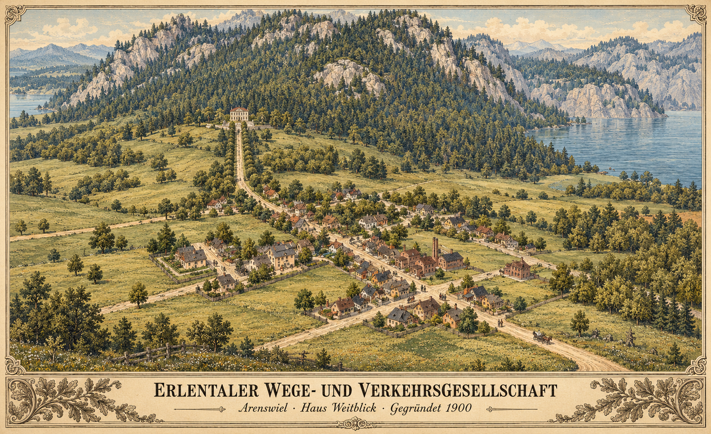

# Ein Anfang in Arenswiel
*Die Gründung der Erlentaler Wege- und Verkehrsgesellschaft, 1900*

**Literarische Szene.** Vom Spieler beauftragte Gründungsgeschichte; Beratungen, Beteiligte und Einzelheiten des Geschäftsalltags sind erzählerische Ausgestaltung, keine Messdaten.

*KI-Bild nach einem Screenshot im Spiel, gestaltet im Stil des späten 19. Jahrhunderts. Künstlerische Interpretation, keine historische Aufnahme.*

Als die Erlentaler Wege- und Verkehrsgesellschaft im Jahr 1900 gegründet wurde, zählte Arenswiel gerade einmal 167 Einwohner. Unterhalb der bewaldeten Berghänge lagen Wohnhäuser, Werkstätten und einige rauchende Schornsteine. Auf den Wiesen zum See hin war noch reichlich Platz. Wer hier lebte, kannte seine Nachbarn – und wusste, wie lange ein Fuhrwerk bis zum nächsten größeren Markt brauchte.

An Arbeit mangelte es in Erlental nicht. Doch zwischen einer bestellten Ware und ihrer Ankunft lagen schlechte Wege, umständliche Absprachen und mitunter Tage des Wartens. Mancher Handwerker hätte mehr verkaufen können, wenn er seine Erzeugnisse verlässlich zu den Kunden gebracht hätte. Mancher Reisende blieb zu Hause, weil Hin- und Rückfahrt einen ganzen Arbeitstag verschlangen.

Aus diesen alltäglichen Schwierigkeiten entstand der Gedanke einer gemeinsamen Verkehrsgesellschaft.

Die ersten Beratungen waren wenig feierlich. Kaufleute, Fuhrleute und Gewerbetreibende legten ihre Rechnungen nebeneinander, verglichen Lieferzeiten und stritten darüber, welche Verbindung zuerst eingerichtet werden sollte. Jeder hatte einen guten Grund, den eigenen Weg für den dringendsten zu halten. Einig war man sich schließlich darin, dass einzelne Fahrten allein das Problem nicht lösen würden. Erlental brauchte regelmäßige Verbindungen, auf die sich Menschen und Betriebe verlassen konnten.

Als Sitz wählte die Gesellschaft ein helles Haus oberhalb von Arenswiel. Eine lange, von Bäumen gesäumte Zufahrt führte aus dem Ort hinauf. Vom Gebäude aus blickte man über Dächer und Wiesen; dahinter lag der See.

**Haus Weitblick** wurde sein Name.

Anfangs standen dort mehr leere Schränke als gefüllte Aktenregale. Im Arbeitszimmer lagen eine Karte Erlentals, ein Kassenbuch und die ersten Entwürfe für Fahrpläne. Die eingezeichneten Linien waren vorerst Absichten. Jede musste vermessen, berechnet und bezahlt werden.

Auch im Dorf begegnete man der Gründung mit gemischten Gefühlen. Der Wirt hoffte auf Reisende. Die Werkstätten hofften auf Aufträge. Ein alter Fuhrmann wollte wissen, ob die neue Gesellschaft ihn künftig beschäftigen oder verdrängen würde. Eine Antwort darauf ließ sich nicht mit einer Festrede geben.

Die Direktion musste sich ihr Vertrauen erst verdienen.

So begann die Geschichte der **Erlentaler Wege- und Verkehrsgesellschaft** mit einem kleinen Ort, einem Haus am Waldrand und einer Aufgabe, deren Größe erst allmählich sichtbar wurde. Noch gab es keinen Bahnhof, an dem Menschen auf den ersten Zug warteten. Noch führte der Weg aus Arenswiel als staubige Straße zwischen den Wiesen hindurch.

Doch oben im Haus Weitblick brannte an diesem Abend länger Licht.
